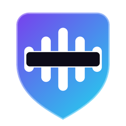
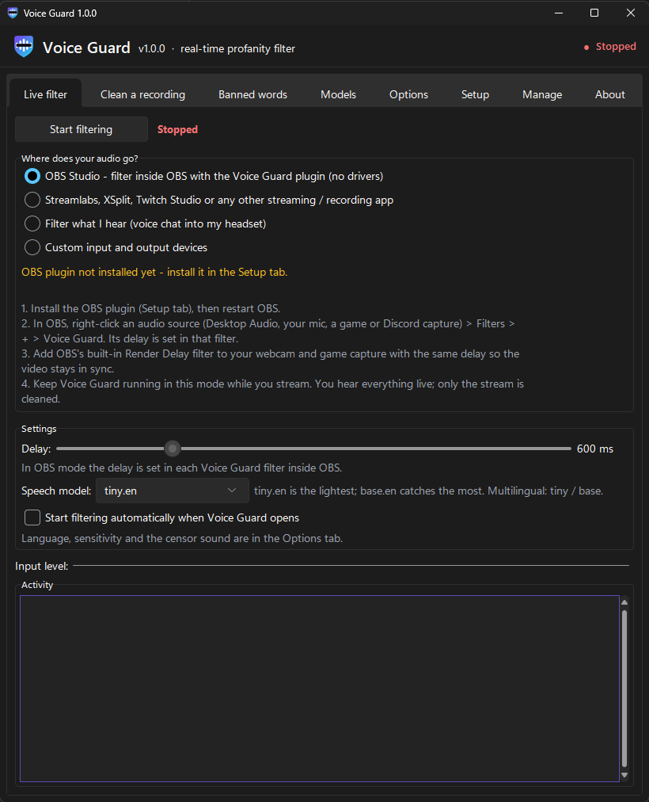
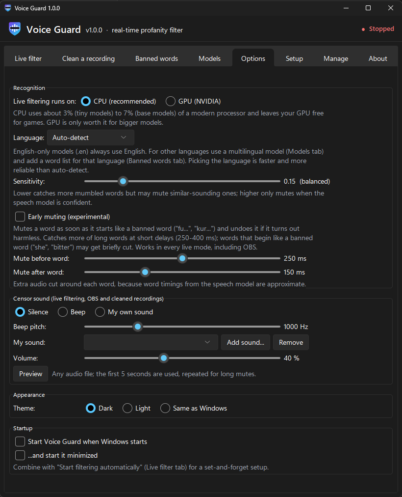
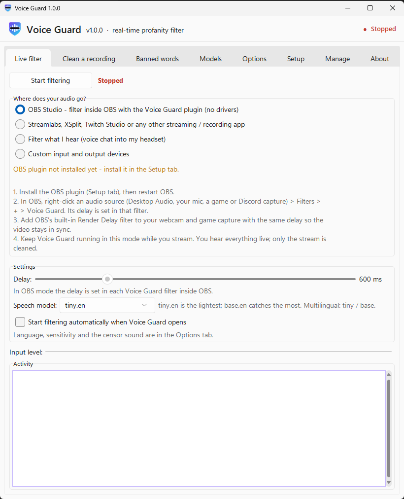
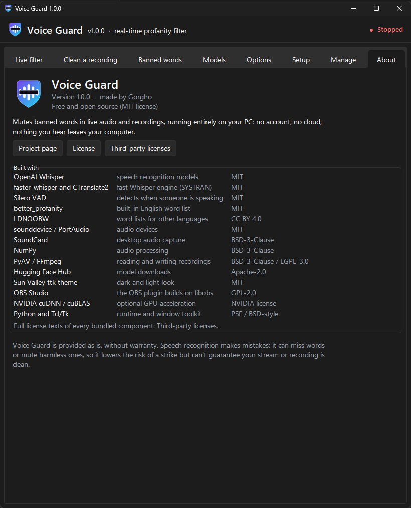

<p align="center">
  
</p>

<h1 align="center">Voice Guard</h1>

<p align="center">
  <b>Real-time profanity filter for streamers and creators. Free, open source, and 100% local.</b><br>
  Mutes or bleeps banned words in Discord, game voice chat or any app before they reach your stream or your upload.
</p>

<p align="center">
  <a href="https://github.com/ShyKaZa/voice-guard/releases/latest"><b>Download for Windows</b></a> ·
  <a href="SETUP.md">Full guide</a> ·
  <a href="#license-and-credits">License</a>
</p>

<p align="center">
  
  
</p>

## Why

Streaming platforms hand out strikes for words *other people* say: a teammate in voice chat, a friend
on Discord, a random player in game. Voice Guard listens to that audio, recognises speech on your own
PC with OpenAI's Whisper, and silences banned words in the copy your viewers get, all within about
half a second.

## Features

- **Filters what you receive**, not just your mic: Discord, in-game voice chat, desktop audio.
- **OBS Studio plugin**: add the "Voice Guard" filter to any audio source; no virtual cable needed.
- **Streamlabs, XSplit, Twitch Studio and others** via VB-CABLE.
- **Clean a recording** for YouTube: ShadowPlay, Game Bar or OBS recordings; the video is copied
  untouched and you get a list of every muted word with timestamps.
- **Light on your PC**: about 3-4% CPU with the default model; your GPU stays free for games.
- **500-600 ms delay** for live filtering, with optional *early muting* for shorter delays.
- **Silence, beep or your own sound** as the censor.
- **Your words, your rules**: built-in English list, 25 language lists, wildcards (`word*`), phrases,
  an allow list, and import from text files.
- **Any Whisper model**: download from the app (tiny to large-v3-turbo) or add your own folder.
- **Dark and light themes**, one-click installer, full uninstaller that can remove everything it downloaded.
- **Private**: no account, no cloud, nothing you hear leaves your computer.

## Get started

1. Download **VoiceGuard-Setup.exe** from the [latest release](https://github.com/ShyKaZa/voice-guard/releases/latest)
   and run it. It installs for your Windows user only, so no admin rights are needed.
   The app isn't code-signed yet, so Windows may say *"Windows protected your PC"*: click
   **More info → Run anyway**.
2. In the app, open **Setup** and click **Install everything** to download the speech model
   (and the OBS plugin if you use OBS).
3. On **Live filter**, pick where your audio goes and press **Start filtering**.

| You use | Pick | Extra needed |
|---|---|---|
| OBS Studio | OBS Studio | the OBS plugin (installed from the app) |
| Streamlabs, XSplit, Twitch Studio, ... | Streamlabs, XSplit, ... | [VB-CABLE](https://vb-audio.com/Cable/) |
| Voice chat cleaned in your own headset | Filter what I hear | VB-CABLE |
| A recording for YouTube | the Clean a recording tab | nothing |

Step-by-step setup for each mode, all options, and measured results are in the **[full guide](SETUP.md)**.

<p align="center">
  
  
</p>

## How well does it work?

In tests with recorded speech it mutes most banned words completely at 500-600 ms (see the
[results](SETUP.md#how-reliable-is-it)). Real voices are messier: mumbling, heavy accents or loud game
audio can let a word slip through, and words that sound alike can get muted. Treat it as a strong
safety net, **not a guarantee**. Every catch is logged so you can see what it did.

English is the best tested. Other languages work with the multilingual models and per-language word
lists; picking the language instead of auto-detect helps a lot.

## Build from source

Windows, Python 3.12:

```bash
python -m venv venv
venv/Scripts/pip install -r requirements.txt
venv/Scripts/python main.py
```

Building the installer and the OBS plugin is described in the [full guide](SETUP.md#running-from-source--building).

## License and credits

Voice Guard is made by **Gorgho** and released under the [MIT License](LICENSE). The OBS plugin in
`obs-plugin-src/` is GPL-2.0-or-later, because it builds on OBS Studio's libobs.

It stands on the shoulders of
[OpenAI Whisper](https://github.com/openai/whisper),
[faster-whisper](https://github.com/SYSTRAN/faster-whisper) and [CTranslate2](https://github.com/OpenNMT/CTranslate2),
[Silero VAD](https://github.com/snakers4/silero-vad),
[better_profanity](https://github.com/snguyenthanh/better_profanity),
the [LDNOOBW word lists](https://github.com/LDNOOBW/List-of-Dirty-Naughty-Obscene-and-Otherwise-Bad-Words) (CC BY 4.0),
[sounddevice](https://github.com/spatialaudio/python-sounddevice), [SoundCard](https://github.com/bastibe/SoundCard),
[PyAV](https://github.com/PyAV-Org/PyAV) / FFmpeg,
the [Sun Valley ttk theme](https://github.com/rdbende/Sun-Valley-ttk-theme)
and [OBS Studio](https://obsproject.com). Full license texts of every bundled component are in
[THIRD_PARTY_NOTICES.txt](THIRD_PARTY_NOTICES.txt).

Voice Guard is not affiliated with OBS, Discord, Twitch, YouTube or OpenAI. It is provided as is,
without warranty.

## Feedback

Found a word it misses, a bug, or want a feature? [Open an issue](https://github.com/ShyKaZa/voice-guard/issues).
If Voice Guard saves your stream, a star on the repo helps others find it.
